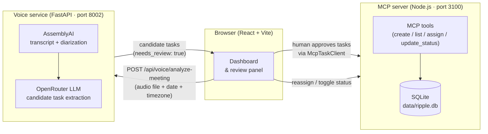

# Ripple — Voice-Aware Collaborative Task Assistant

Ripple turns a short consented team meeting recording into a set of human-approved,
trackable commitments. Audio is transcribed and diarized, candidate tasks are extracted
by an LLM, a human reviews and approves them, and only approved tasks are saved through
an MCP server backed by SQLite.

> **Hackathon judges:** see [`docs/JUDGE_QUICKSTART.md`](docs/JUDGE_QUICKSTART.md) for a
> step-by-step local demo runbook.

---

## Problem statement

Team commitments made in meetings are routinely forgotten or lost in chat threads.
Ripple gives every recording a structured output: a list of tasks with owners, deadlines,
and transcript evidence — reviewed and approved by a human before anything is saved.

---

## How it works



**Analysis path** (left side): upload → transcribe → diarize → extract candidates → human review.
**Task-write path** (right side): only approved tasks are sent to the MCP server and persisted.

The voice service never saves tasks or calls MCP. No task is persisted without human approval.

---

## Key features

| Feature | Status |
|---|---|
| Audio transcription with timestamps | ✅ Implemented (AssemblyAI) |
| Anonymous speaker diarization (`SPEAKER_01`, `SPEAKER_02`, …) | ✅ Implemented |
| AI-generated candidate tasks with transcript evidence | ✅ Implemented (OpenRouter LLM) |
| Human speaker mapping, task editing, approval, and rejection | ✅ Implemented (React dashboard) |
| MCP task creation, listing, assignment, and status updates | ✅ Implemented |
| SQLite persistence via `node:sqlite` (Node ≥ 22.5.0) | ✅ Implemented |
| Mock mode for frontend-only development | ✅ Available (`VITE_USE_MOCK_TASK_CLIENT=true`) |

---

## Technology stack

| Layer | Technology |
|---|---|
| Frontend | React 19, TypeScript, Vite 8 |
| MCP server | Node.js 24, TypeScript, `@modelcontextprotocol/sdk` v1, Express 5 |
| Voice service | Python 3.11+, FastAPI, AssemblyAI, OpenRouter |
| Database | SQLite (`node:sqlite` built-in, Node 24) |
| Transport | MCP Streamable HTTP (spec 2025-11-25+) |
| Tests | Node.js built-in test runner (backend), pytest (voice service) |

---

## Repository structure

```
ripple-mcp/
├── apps/
│   └── web/                   # React + Vite frontend
│       └── src/
│           ├── App.tsx         # Main dashboard
│           ├── MeetingReviewPanel.tsx
│           └── services/
│               ├── taskClient.ts       # TaskClient interface
│               ├── mcpTaskClient.ts    # Live MCP adapter
│               ├── mockTaskClient.ts   # Mock adapter (dev/demo)
│               └── voiceAnalysis.ts    # Voice service client
├── services/
│   ├── mcp-server/
│   │   └── src/
│   │       ├── index.ts        # Express + MCP server
│   │       ├── db.ts           # SQLite layer
│   │       └── tools/
│   │           └── tasks.ts    # MCP tool registrations
│   └── voice-service/
│       ├── app/                # FastAPI application
│       └── tests/              # pytest suite (mocked providers)
├── tests/
│   └── task-tools.test.ts      # Node.js backend test suite
├── docs/
│   ├── JUDGE_QUICKSTART.md     # ← start here for the demo
│   ├── architecture.md
│   ├── TEAM_SETUP.md
│   └── CONTRIBUTING.md
└── data/
    └── ripple.db               # SQLite database (git-ignored)
```

---

## Audio format and upload limits

| Limit | Value |
|---|---|
| Supported formats | WAV, MP3, M4A, WebM (audio-only) |
| Maximum file size | 25 MB |
| Maximum duration | 3 minutes (180 s) |
| Video files | Rejected (415 `UNSUPPORTED_AUDIO_TYPE`) |

Format is detected from file bytes, not filename or MIME type. Video-container files (MP4
with a video track, WebM with a video track) are rejected before any provider is called.

---

## Prerequisites

| Tool | Version |
|---|---|
| Git | any recent |
| Node.js | ≥ 22.5.0 (for `node:sqlite`; Node 24 tested) |
| npm | bundled with Node.js |
| Python | 3.11+ |
| AssemblyAI API key | required for live meeting analysis |
| OpenRouter API key + model | required for live task extraction |

Mock mode lets you run the frontend and MCP server without any API keys.

---

## Quick start (Windows PowerShell)

### Terminal 1 — MCP backend

```powershell
git clone https://github.com/Yengeshwaran/ripple-mcp.git
cd ripple-mcp
npm ci
npm run mcp:typecheck   # should exit with zero errors
npm test                # 26 tests, 0 failures
npm run mcp:dev         # server on http://localhost:3100
```

### Terminal 2 — Voice service

```powershell
cd services/voice-service
python -m venv .venv
.\.venv\Scripts\Activate.ps1
pip install -r requirements-dev.txt
Copy-Item .env.example .env
# Edit .env: add ASSEMBLYAI_API_KEY, OPENROUTER_API_KEY, OPENROUTER_MODEL
uvicorn app.main:app --port 8002 --reload
```

### Terminal 3 — Frontend

```powershell
cd apps/web
npm ci
npm run build           # production type check + Vite build
npm run dev -- --port 5174 --strictPort
```

Open **http://localhost:5174**.

---

## API and health endpoints

| Endpoint | Method | Description |
|---|---|---|
| `http://localhost:3100/mcp` | POST | MCP Streamable HTTP endpoint |
| `http://localhost:3100/mcp` | GET | Returns 405 (not supported) |
| `http://localhost:3100/health` | GET | `{"status":"ok","server":"ripple-mcp","version":"0.1.0"}` |
| `http://localhost:8002/api/voice/analyze-meeting` | POST | Meeting analysis (multipart/form-data) |
| `http://localhost:8002/health` | GET | `{"status":"ok"}` |

The frontend Vite dev server (`apps/web/vite.config.ts`) proxies `/mcp` → `localhost:3100`
and `/api/voice` → `localhost:8002`, so both services are reachable from `localhost:5174`.

---

## MCP tools

| Tool | Required inputs | Optional inputs | Notes |
|---|---|---|---|
| `ping` | — | `message` | Connectivity check |
| `create_task` | `title` | `description`, `assignee`, `deadline` (ISO 8601) | Status set to `open` |
| `list_tasks` | — | `status`, `assignee` | Newest-first |
| `assign_task` | `task_id`, `assignee` | — | Returns `isError:true` if task not found |
| `update_task_status` | `task_id`, `status` (`open`\|`in_progress`\|`done`) | — | Returns `isError:true` if task not found |

---

## Automated tests

```powershell
# Backend (from repo root)
npm run mcp:typecheck   # TypeScript — exit 0, zero errors
npm test                # 26 tests, 8 suites, 0 failures

# Frontend (from apps/web)
npm run build           # tsc -b + Vite build

# Voice service (from services/voice-service, venv active)
python -m pytest -q     # 94 tests, 0 failures — all mocked, no keys needed
```

All automated tests use mocked or in-process dependencies. No live API calls or network
access are required to run them.

---

## Privacy and security

- Never commit `.env` files or API credentials.
- Never commit private meeting recordings or transcripts.
- The voice service writes audio to a random temp file and deletes it after processing.
- Speaker labels are anonymous (`SPEAKER_01`, …). They are not identities until a human maps them.
- The extraction model receives transcript text only — never raw audio.
- SQLite database files (`*.db`) are git-ignored.
- The MCP server binds to all interfaces on port 3100 (localhost is the intended deployment).

---

## Known limitations

- Live-provider results so far are in [`services/voice-service/docs/FEASIBILITY.md`](services/voice-service/docs/FEASIBILITY.md). Tamil-English code-switching is not yet tested.
- Speaker labels can be wrong on cross-talk or very short turns; the user must confirm the mapping.
- MP3 and browser-recorded WebM audio-length checks run after transcription (a small cost is incurred before rejection for over-long files of those formats).
- The `deepseek/deepseek-v4-flash-0731` model on OpenRouter has not yet been live-tested. `openai/gpt-oss-20b` was live-tested on 20 Oct 2026.
- Task dependencies are not extracted (not in the agreed contract).
- No production deployment — this is a local hackathon demo.

---

## Troubleshooting

| Symptom | Likely cause | Fix |
|---|---|---|
| `SERVICE_NOT_CONFIGURED` (503) | Missing `ASSEMBLYAI_API_KEY` or `OPENROUTER_API_KEY` | Add keys to `services/voice-service/.env` |
| `EXTRACTION_PROVIDER_ERROR` (502) | Invalid API key or model not available on OpenRouter | Verify key; try `openai/gpt-oss-20b` as a known-good model |
| `TRANSCRIPTION_PROVIDER_UNAVAILABLE` (503) | AssemblyAI timeout or rate limit | Wait and retry; `retryable: true` in the error body |
| Port 3100 in use | Another process | `netstat -ano \| findstr :3100`; kill the PID or change `PORT` env var |
| Port 8002 in use | Another process | Change `--port` in the uvicorn command |
| Port 5174 in use | Another process | Change `--port` in the Vite command |
| `UNSUPPORTED_AUDIO_TYPE` (415) | File contains video or is wrong format | Re-export as audio-only M4A or WAV |
| `FILE_TOO_LARGE` (413) | File > 25 MB | Trim or re-encode at lower bitrate |
| `AUDIO_TOO_LONG` (413) | Recording > 3 minutes | Trim to under 3 minutes |
| Empty task list after analysis | No commitments in audio, or missing `meeting_date`/`timezone` | Check audio content; supply both fields for deadline extraction |
| Tasks not persisted | Wrong `RIPPLE_DB_PATH` or server not running | Check MCP server terminal; verify path |
| Frontend shows "Connecting" | MCP server not running or wrong port | Start `npm run mcp:dev`; check proxy in `vite.config.ts` |
| Mock mode active | `VITE_USE_MOCK_TASK_CLIENT=true` | Remove or set to `false` for real MCP integration |

---

## Further reading

- [`docs/JUDGE_QUICKSTART.md`](docs/JUDGE_QUICKSTART.md) — complete local demo runbook
- [`docs/architecture.md`](docs/architecture.md) — architecture notes
- [`docs/TEAM_SETUP.md`](docs/TEAM_SETUP.md) — team onboarding
- [`services/voice-service/README.md`](services/voice-service/README.md) — voice service detail
- [`services/voice-service/docs/FEASIBILITY.md`](services/voice-service/docs/FEASIBILITY.md) — live-provider results
